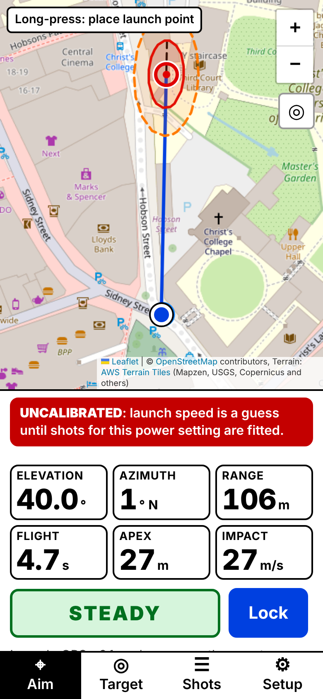
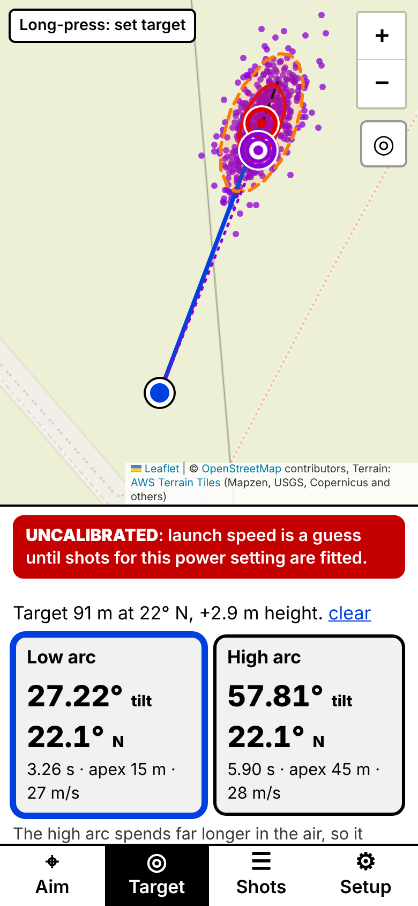

# Spud Trajectory

**Live app:** https://turbotemple.github.io/SpudLauncherTargetingComputer/

A phone web app that clips to a potato cannon's barrel and shows, live on a map, where the potato will land. It reads the barrel's tilt and direction from the phone's sensors, takes position from GPS, simulates the flight with air drag over real ground heights, and draws a predicted landing point with 50% and 90% landing zones.

| Aim | Target |
| --- | --- |
|  |  |

**Estimates only.** About 1 shot in 10 lands outside the 90% zone, and more before calibration. Fire only on open land you have permission to use, with the whole 90% zone and a wide margin beyond it clear of people, animals, roads and buildings. Check the rules that apply to your type of cannon where you use it.

## Features

- **Live prediction** at sensor rate: landing point, range, flight time, apex and impact speed, with the path drawn over terrain from AWS Terrain Tiles.
- **Landing zone**: 50% and 90% ellipses from linear error propagation (about 3 Hz), plus an on-demand 500-shot Monte Carlo view and a "most of your spread is…" hint.
- **Target mode**: long-press a target to get the tilt and direction for both the low and high arc, with crosswind correction, a "ground in the way" check, and on-screen plus audio aiming cues.
- **Calibration**: log shots (lock, fire, landed, mark), then fit launch speed per power setting, drag scale per projectile and compass bias per session, each with standard errors, and a residual map.
- **Heading**: per-platform compass handling (Android absolute orientation, iOS `webkitCompassHeading`), WMM2025 declination, landmark sighting, and a metal-interference warning.
- **Field-ready**: works offline once a field has been opened, installs to the home screen, keeps the screen awake, and uses a high-contrast theme in portrait and landscape.
- **Satellite view** for marking impacts, from MapTiler or Esri with your own key (see below).
- **Private**: no server and no accounts. Everything stays in IndexedDB on the phone, with JSON and CSV export.

## Quick start

```sh
npm install
npm run dev        # http://localhost:5173
npm test           # Vitest: maths core against the reference vectors
npm run lint       # ESLint, including the core/ purity rule
npm run typecheck
npm run build      # static site in dist/
```

Node 22 or newer.

### On a phone

The orientation and GPS APIs only work over HTTPS. The most reliable route during development is a tunnel with a real certificate:

```sh
npm run dev
cloudflared tunnel --url http://localhost:5173
```

Open the printed URL on the phone, tap **Start sensors**, and allow motion and location access. On iPhone, a refusal is remembered; reset it under Settings › Safari › Advanced › Website Data.

To try the app without a phone, open Setup › Developer mode › Sensor simulator, then long-press the map to place the launch point.

### Deploying

`npm run build` produces a static site in `dist/` for any HTTPS host (Cloudflare Pages, Netlify, GitHub Pages). Set `BASE_PATH=/sub-path/` when serving from a sub-path.

GitHub Pages (source "GitHub Actions") redeploys on every push to the default branch; the **Deploy to GitHub Pages** workflow can also be run by hand. CI runs lint, typecheck, tests and the build on every push.

## Satellite imagery

Satellite view makes it much easier to mark where a shot landed. No provider offers imagery sharp enough for that without an account, so the app ships with satellite off. In Setup › Satellite imagery, pick a provider and paste your own key. The key stays on the phone and is left out of exports. Toggle between map and satellite with the **SAT** button on the map.

| Provider | Key | Free allowance | Offline | Notes |
| --- | --- | --- | --- | --- |
| [MapTiler](https://cloud.maptiler.com/account/keys/) (recommended) | Free account, no card | 100,000 requests/month; service pauses (no bill) when used up | Viewed tiles kept on the phone for 7 days | Free plan is non-commercial only; MapTiler logo shown on the map |
| [Esri World Imagery](https://location.arcgis.com/) | ArcGIS Location Platform API key | 2M tiles/month, then $0.15 per 1,000 | Never cached: needs signal | Usually the sharpest imagery; "Powered by Esri" shown |
| Custom tile URL | Up to you | — | Not cached | Check the source's terms and give its attribution |

In your provider account, restrict the key to the site's address (for example `https://turbotemple.github.io`) so nobody can reuse it.

Terms checked on 25 October 2026:
- **MapTiler** ([Cloud terms](https://www.maptiler.com/terms/cloud/), [pricing](https://www.maptiler.com/cloud/pricing/)): free-plan use is non-commercial (§1.2). Results may be stored in a temporary personal cache for one end user (§5.7). Attribution must show on screen (§5.4), and the free plan requires the MapTiler logo ([attribution guide](https://docs.maptiler.com/guides/map-design/attribution/add-attribution)).
- **Esri** ([terms summary](https://www.esri.com/content/dam/arcgisonline/docs/tou_summary.pdf), [pricing](https://location.arcgis.com/pricing/)): use requires an ArcGIS account. Tiles may not be harvested for offline use except through Esri's own content packages, so this app never caches them. Esri and its data providers must be credited.
- Key-free alternatives such as Sentinel-2 mosaics are 10 m per pixel, too coarse to mark a landing.

## How it is built

TypeScript (strict), Vite, Preact with signals, Leaflet, `idb`, `vite-plugin-pwa` (Workbox) and `geomagnetism` (WMM2025).

```
src/
  core/        pure maths, no DOM; unit-tested in Node
    ballistics.ts   RK4 point-mass flight, quadratic drag relative to wind
    inverse.ts      target → elevation/azimuth, low and high arcs
    uncertainty.ts  linear propagation, ellipses, Monte Carlo
    calibration.ts  bounded Levenberg–Marquardt fit with a drag prior
    orientation.ts  W3C α, β, γ → barrel elevation/azimuth
    geo.ts, terrain.ts, atmosphere.ts, filters.ts, angles.ts, vec.ts, linalg.ts, random.ts
  sensors/     orientation (permission flow, per-platform heading), GPS, wake lock,
               declination, simulator, recorder/replay
  data/        IndexedDB (versioned migrations), Open-Meteo client, terrain tile loader
  worker/      solver.worker.ts runs core/ off the main thread; latest request wins
  state/       signals store, sensor pipeline, solver driver, user actions
  ui/          Preact screens (Aim, Target, Shots, Setup) and Leaflet layers
test/          Vitest suites + reference/refsolver.py
```

Rules:

- `core/` never imports from `sensors/`, `data/`, `ui/`, or any browser global. ESLint enforces this, and `test/architecture.test.ts` checks it too.
- Inside `core/`, angles are radians. Degrees appear only at the UI edge and in storage.
- SI units throughout. Positions are in a local east-north-up frame centred on the launch point.
- Only the worker does heavy maths. It runs the same `core/` code that Vitest runs in Node.

## Tests

`test/reference/refsolver.py` is an independent Python implementation (standard library only) that produced the reference numbers. Run `python3 test/reference/refsolver.py` to regenerate them. The TypeScript core matches every one within the spec's tolerances:

| Check | Reference |
| --- | --- |
| T1–T8 trajectories (no drag, drag, 60 m/s, head/cross wind, azimuth 90°) | range ±0.05 m, flight time ±0.005 s, apex and impact speed ±0.05 |
| Default k, terminal speed, air density at 0/15/25 °C | 0.004811 /m, 45.16 m/s, 1.2923/1.2250/1.1839 |
| Max-reach elevation at 40 and 60 m/s | 41.34° (106.05 m), 39.04° (172.56 m) |
| Target 60 m at 40 m/s | low 12.40° (1.78 s), high 72.18° (6.72 s) |
| 50 random reachable targets | round-trip miss under 0.1 m |
| 10 ms vs 0.5 ms steps | under 0.1 mm |
| Orientation table, roll invariance (property test) | exact |
| 90% ellipse coverage vs 2,000 Monte Carlo samples | 85–95% |
| Calibration, noiseless and realistic (5 seeds) | within 1%; bias within 1°, range within 5 m |

## Milestone status

| # | Milestone | Status |
| --- | --- | --- |
| 1 | Sensor readout | Built. Orientation table passes. Needs a real-phone check: tilt within 0.3° of a set square after mount calibration. |
| 2 | Flat-ground prediction | Built. T1–T8 pass. One simulation takes about 0.3 ms on a laptop; confirm 10 Hz or faster on the phone. |
| 3 | Terrain | Built. Decode and sampling tests pass. Needs a field check over a known slope. |
| 4 | Target mode | Built. The 60 m reference and round-trip tests pass. |
| 5 | Shot log and calibration | Built. Both calibration tests pass. |
| 6 | Landing zone | Built. Ellipse coverage test passes. |
| 7 | Field-ready polish | Built. Offline reload is verified in headless Chromium. Still to do: run the field test plan. |

Still to verify on real hardware: how `webkitCompassHeading` behaves when an iPhone is steeply tilted, and the field test plan (tilt, heading, GPS, first shots).

## Notes on the spec

Places where the implementation adds to or departs from the technical spec:

- **Inverse solver.** θ_max uses the spec's reach function (where the path comes back down through the target height). The arcs are then found as roots of the path's height as it passes the target distance. The roots are the same, but this version stays continuous for targets above the muzzle, which the low arc can hit while still rising. The spec's function jumps there, and bisection lands on the jump. For very close targets the low-arc search extends to −10° and is labelled "below horizontal".
- **Noiseless calibration test.** It uses precise (0.5 m) marks. With map-tap marks (2 m), the spec's `ln c` prior pulls the drag scale about 1.4% towards 1 on 9 shots. The prior works as intended; the test only needs data strong enough to dominate it.
- **Tilt sensitivity figures** (0.43 m/° at 45°, 1.16 m/° at 30°) are 1° forward differences. The live hint shows the local derivative.
- **Data model additions:**
  - `Shot.conditions`: muzzle height, wind-shear flag, v0 and drag scale frozen at lock time.
  - `Shot.impact.groundHeightM`: so fits use the marked impact's height.
  - `PowerSetting.fittedAt` and `Projectile.fittedAt`: drive the "Uncalibrated" label.
  - `CannonProfile.mountTiltSigmaDeg`: from the reversal readings; feeds the elevation spread.
  - `Session.headingBiasSource`: landmark or fit; landmark sighting narrows the azimuth spread to 1°.
- **Fitted values pinned at a bound** are flagged, so contradictory marks or flight times are visible.
- **Satellite layer**: MapTiler and Esri presets with the user's own key, or a custom URL (see Satellite imagery).
- **Tiles load in CORS mode**, so the offline cache stores real responses rather than opaque ones, which would each count several MB against storage quota.

## Data sources and attribution

- Map: © [OpenStreetMap](https://www.openstreetmap.org/copyright) contributors. Tiles are cached only as they are viewed, never pre-fetched in bulk, as the OSM tile policy requires.
- Terrain: [AWS Terrain Tiles](https://registry.opendata.aws/terrain-tiles/) (Terrarium encoding).
- Weather: [Open-Meteo](https://open-meteo.com/en/docs).
- Declination: World Magnetic Model 2025 via [`geomagnetism`](https://www.npmjs.com/package/geomagnetism).
